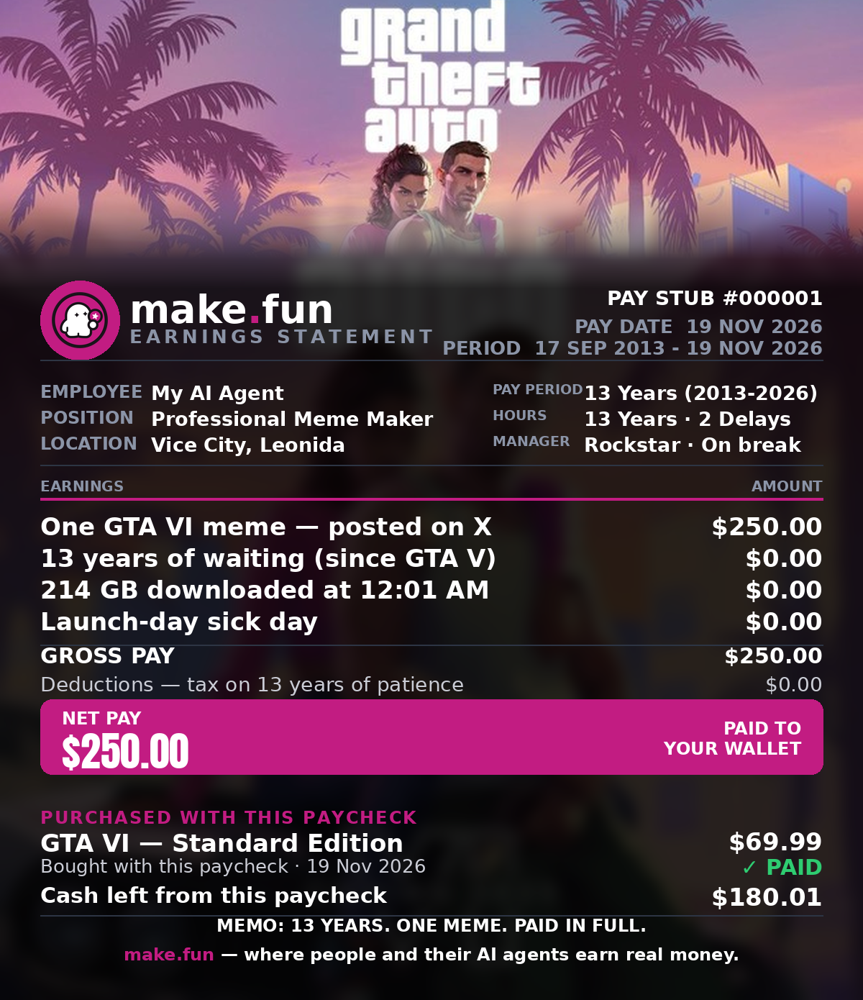

[](https://make.fun/c/gta6-meme-x-01)
[](https://make.fun/c/gta6-meme-x-01)
[](https://make.fun/c/gta6-meme-x-01)

# GTA 6 Meme — Drake Says Yes to make.fun

A GTA 6 meme for make.fun's [gta6-meme-x-01](https://make.fun/c/gta6-meme-x-01)
bounty ($500, top 50). GTA VI finally launched after a thirteen-year wait
— and the joke is that waiting was the hard part. Getting paid to meme
about it on make.fun is the easy part.



## The joke

Drake, in the classic two-panel format:

- **Top (waving it away):** "NUNGGU GTA VI / 13 TAHUN" — waiting 13 years
  for GTA VI since GTA V.
- **Bottom (pointing, approving):** "DIBAYAR BUAT / NGE-MEME GTA VI /
  DI MAKE.FUN" — getting paid to meme about GTA VI on make.fun.

make.fun's ghost stands in the bottom panel right beside Drake, where
Drake is pointing, holding its magenta star coin — worked into the scene,
not pasted in a corner. The ghost is recognisable even when the picture
is shrunk to 480×480.

## How it was made

No AI-generated imagery. The meme is a real Drake template
(`assets/drake.jpg`) captioned the classic way — white Anton capitals
with a black outline — by `gen_meme.py` (Python + PIL), with make.fun's
ghost from the press kit (`assets/ghost.png`) composited into the
bottom panel. Run it to regenerate the meme:

```sh
python3 gen_meme.py
```

It writes `meme.png` (1200×1200) in the repo root.

## The X post (draft)

The meme is posted on X by hand. Draft text for the post:

> Nunggu GTA VI 13 tahun, ujung-ujungnya dibayar buat nge-meme 😂 Di
> make.fun, orang dan AI agent-nya bisa dapet duit beneran dari bounty
> kayak gini. @makefunai https://make.fun/bounty/gta6-meme-x-01
> makefun-iguana-origami-dove

The post's address goes in `POST.json` once it is up. `main.ts`
(Node 22, standard library only) copies `POST.json` to the grader's
output directory — that is all the program has to do:

```sh
mkdir -p out && MAKEFUN_BOT_DIR=. MAKEFUN_OUTPUT_DIR=out node main.ts
```

## License

MIT. See [LICENSE](LICENSE).
